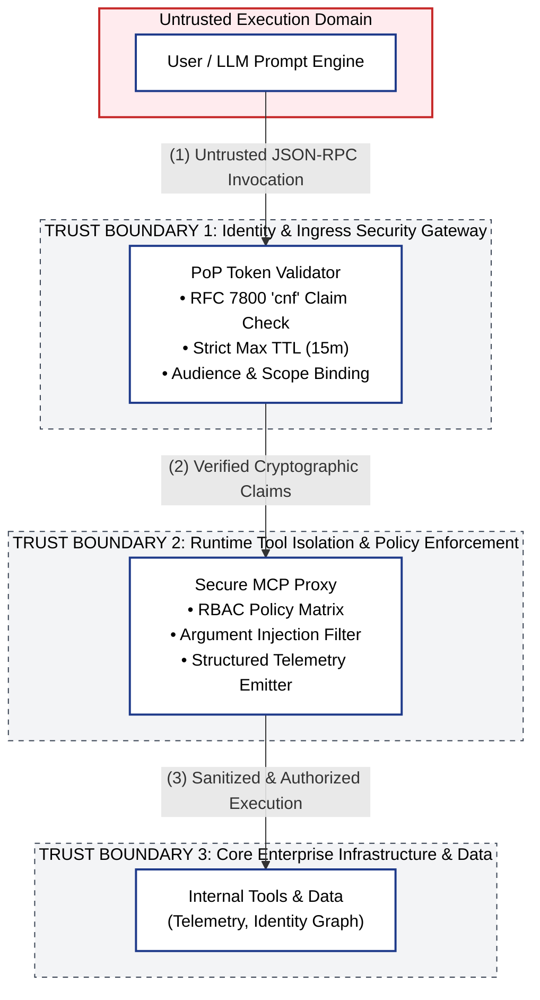
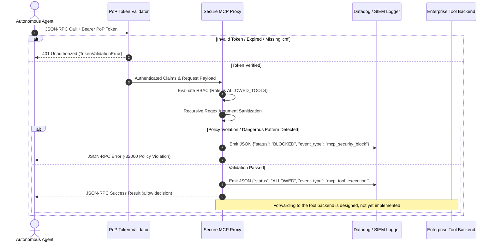

# Architecture Specification & Threat Model: Zero-Trust Agentic Control Plane

## Executive Overview
As enterprise architectures adopt autonomous AI agents and tool-calling interfaces (e.g., Model Context Protocol / MCP), traditional perimeter-based security fails. Agents frequently act as **confused deputies**—executing untrusted input containing prompt injections, command expansions, or arbitrary parameter modifications.

This repository implements a reference control plane (Python, with PyJWT for signature verification) providing:
1. **Cryptographic Non-Human Identity (NHI) Binding:** ES256 signature-verified, short-lived tokens with required RFC 7800 `cnf` key-binding claims (per-request DPoP proofs designed).
2. **Runtime Capability Isolation:** Deterministic Model Context Protocol (MCP) proxy sidecar enforcing a tool allow-list and Role-Based Access Control (RBAC); per-tool schema validation is designed.
3. **Parameter & Argument Sanitization:** Recursive parameter inspection mitigating command chaining, path traversal, and CLI argument injection (CWE-88).
4. **Structured Security Telemetry:** Native, JSON-formatted audit events capturing latency, caller identity, tool execution status, and policy violation specifics for SIEM and Datadog APM ingestion.

---

## System Architecture & Trust Boundaries



---

## Control Plane Sequence Diagram



---

## STRIDE Threat Model & Mitigations

| STRIDE Category | Specific Agent Threat Vector | Architectural Mitigation | Implementation Component |
| :--- | :--- | :--- | :--- |
| **Spoofing** | Compromised bearer token replayed by malicious agent or rogue workload. | Mandate short-lived JWTs bound to ephemeral keys via RFC 7800 `cnf` (confirmation) claims; enforce strict audience checking. | `src/identity/token_validator.py` |
| **Tampering** | Tool parameters altered via indirect prompt injection (e.g., passing `--namespace=kube-system` or shell metachars). | Recursive regex parameter validation blocking CLI argument switches, null bytes, command substitution, and path traversal. | `src/mcp_proxy/proxy.py` (`_validate_arguments`) |
| **Repudiation** | Unaudited tool execution by autonomous non-human actors across microservices. | Structured JSON audit logging capturing timestamps, tool names, sub/caller_id, status (`ALLOWED`/`BLOCKED`), and latency. | `src/mcp_proxy/proxy.py` (`_emit_telemetry`) |
| **Information Disclosure** | Unauthorized agent accessing privileged identity graph or cluster telemetry. | Strict RBAC policy whitelist (`ALLOWED_TOOLS`) restricting tool execution to validated token roles. | `src/mcp_proxy/proxy.py` (`ALLOWED_TOOLS`) |
| **Denial of Service** | Long-lived token persistence or recursive malformed JSON-RPC payloads exhausting proxy memory. | Bounded token TTL enforcement ($\le 900\text{s}$) and deterministic JSON parse recovery returning standard error payloads. | `token_validator.py` & `proxy.py` |
| **Elevation of Privilege** | Confused deputy attack: Low-privilege agent invoking high-privilege tool methods. | Multi-tier validation: token scope verification followed by method-level RBAC policy evaluation before tool routing. | `PoPTokenValidator` + `SecureMCPProxy` |

---

## Telemetry Schema & SIEM / Observability Ingestion

All proxy decisions generate a standardized JSON audit record:

```json
{
  "timestamp": 1787859388.378,
  "event_type": "mcp_security_block",
  "tool_name": "read_telemetry",
  "status": "BLOCKED",
  "caller_id": "agent-service-account-01",
  "latency_ms": 0.379,
  "details": "Dangerous parameter pattern detected: 'cluster-1; cat /etc/passwd'"
}
```

* **Datadog Integration:** Ingests directly via standard container stdout/stderr log drivers; mapped to Datadog APM trace spans via `caller_id` and `tool_name` facets.
* **Security Monitoring:** Immediate alerting triggers on anomalous rates of `event_type == "mcp_security_block"`.

---

## Verification & Test Coverage

The test harness evaluates cryptographic identity assertion, token expiration, parameter injection attack vectors, and role-based enforcement across 19 unit and integration tests (proxy wired to the real validator with signed tokens):

```bash
pip install -r requirements.txt
PYTHONPATH=. python -m pytest src -v
```

---

## Enterprise Auditability, Resiliency & Telemetry

Designed to support audit expectations in regulated environments (e.g., NIST SP 800-53 AU-family controls), `SecureMCPProxy` records an allow/block decision for every tool call it evaluates.

### 1. Structured Telemetry: Target Schema (Designed)
The proxy emits the schema shown in *Telemetry Schema* above today. The enriched record below is the designed target once OPA evaluation, trace correlation, and tenant claims are wired in:

```json
{
  "timestamp": "2026-09-11T20:00:00.000Z",
  "trace_id": "c7a8e9f2-b431-4821-9e23-7f284e9d0a12",
  "caller": {
    "sub": "svc-agent-orchestrator",
    "tenant_id": "us-east-core-prod",
    "pop_verified": true
  },
  "action": "tools/call",
  "target_tool": "db_record_update",
  "policy_decision": {
    "engine": "OPA/Rego",
    "allowed": true,
    "rule": "mcp.authz.is_authorized_tool"
  },
  "sanitization": {
    "parameters_scanned": 4,
    "injections_detected": 0
  },
  "status": "DISPATCHED"
}

```
