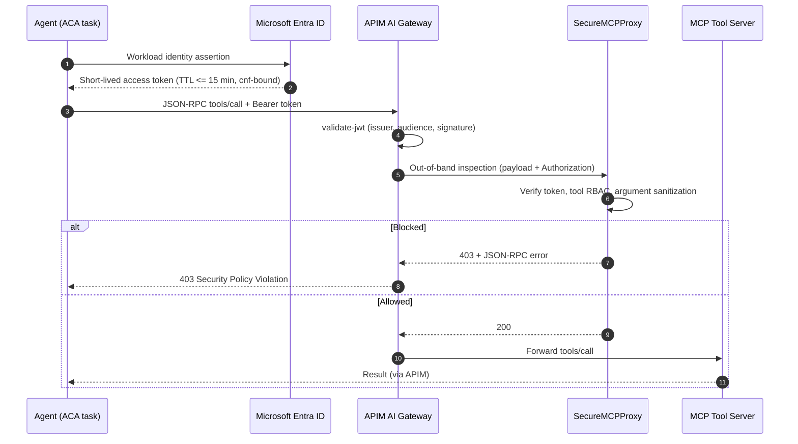

# Architecture Spec: Zero-Trust MCP Gateway (Artifact 1)

**Author:** Jayce Hill | Principal AI Security Architect
**Scope:** The control plane that sits between an AI agent and the tools it calls over the Model Context Protocol (MCP). Each control below is marked **Implemented** (code and tests in this repo) or **Designed** (specified here, not yet built).

---

## 1. Problem

An agent that can call tools turns any text it reads into a possible instruction. A poisoned document, ticket, or web page can steer the agent into calling a tool with attacker-chosen arguments. The tool sees a legitimate caller and executes. The gateway's job is to make the decision to execute **independent of the model**: who is calling, which tool, with what arguments, under what policy.

## 2. Request Flow

## 3. Trust Boundaries

| Boundary | Enforced by | What crosses it |
| :--- | :--- | :--- |
| TB1 · Ingress | APIM gateway | Only requests carrying a valid, audience-bound token |
| TB2 · Policy | `SecureMCPProxy` | Only allow-listed tools, for permitted roles and scopes, with sanitized arguments |
| TB3 · Execution | Isolated tool runtime | Only the specific tool call that passed TB1 and TB2 |

## 4. Controls and Status

| Control | Where | Status |
| :--- | :--- | :--- |
| JSON-RPC 2.0 structural validation | `src/mcp_proxy/proxy.py` | **Implemented** |
| JWT signature verification (ES256, explicit algorithm allow-list, rejects `alg: none`) | `src/identity/token_validator.py` | **Implemented** |
| Audience, TTL (<= 15 min), scope, and RFC 7800 `cnf` key-binding checks | `src/identity/token_validator.py` | **Implemented** |
| Tool allow-list and role-based access per tool | `SecureMCPProxy.ALLOWED_TOOLS` | **Implemented** |
| Recursive argument sanitization: command chaining, path traversal, CWE-88 argument injection, null/CRLF | `SecureMCPProxy._validate_arguments` | **Implemented** |
| Structured security telemetry (allow/block decisions) | `SecureMCPProxy._emit_telemetry` | **Implemented** |
| Integration tests: proxy + real validator with signed tokens | `src/mcp_proxy/test_integration.py` | **Implemented** |
| Default-deny OPA/Rego tool policy | `src/identity/policies/mcp_tool_policy.rego` | **Implemented** (policy authored); **Designed**: OPA sidecar evaluation from the proxy |
| APIM `validate-jwt` + out-of-band inspection call | `iac/azure/apim-policy.xml` | **Implemented** (policy); **Designed**: proxy HTTP endpoint `/v1/mcp/inspect` returning 403 on block |
| Per-request DPoP proof verification (RFC 9449) | — | **Designed** |
| Per-tool JSON Schema validation of arguments | — | **Designed** |
| Indirect prompt injection (XPIA) inspection of tool *responses* before re-entry to agent context | — | **Designed** |
| Forwarding allowed calls to upstream MCP servers | — | **Designed** |
| Kernel-isolated tool execution (gVisor / Wasm) | — | **Designed** |

## 5. Known Limits of the Current Build

* Argument sanitization is pattern-based. It is one layer, not a prompt-injection solution, and it rejects some legitimate input containing shell metacharacters. Per-tool JSON Schemas are the planned replacement for general-purpose patterns.
* The proxy is a policy decision point implemented as a Python class. It returns allow/block decisions and does not yet forward calls to a tool server.
* The `cnf` check confirms the token is key-bound; it does not yet verify a per-request proof signed by that key.

## 6. Related Artifacts

* Identity spec: [`identity-architecture.md`](./identity-architecture.md)
* Threat matrix: [`threat-matrix.md`](./threat-matrix.md)
* Telemetry and audit spec: [`audit-observability.md`](./audit-observability.md)
* Infrastructure: [`iac/azure/`](../iac/azure/)
