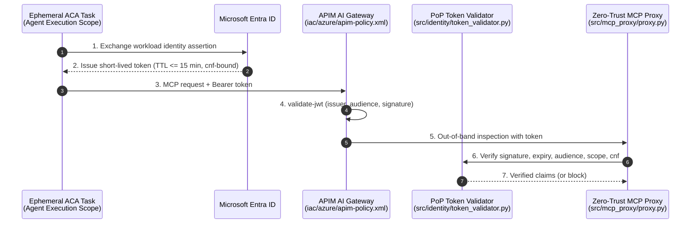

# Architecture Spec: Non-Human Identity (NHI) Governance & Proof-of-Possession Tokens (Artifact 2)

**Author:** Jayce Hill | Principal AI Security Architect

## Executive Overview

In autonomous agentic workflows, long-lived API keys and static service-principal secrets create severe risk: identity hijacking, confused-deputy abuse, and excessive agency.

This specification defines a **dual-trust identity architecture** using **Microsoft Entra workload identity** for agents. Agents receive short-lived OAuth 2.0 access tokens bound to a key (RFC 7800 `cnf` claim), and every tool invocation is checked against that identity before it executes. Each control is marked **Implemented** (code and tests in this repo) or **Designed** (specified, not yet built).

---

## Identity Boundary Architecture

---

## Key Identity Controls

| Control Layer | Implementation Pattern | Security Property | Status |
| :--- | :--- | :--- | :--- |
| **Identity Delegation** | Entra workload identity (user-assigned managed identity today; Entra Agent ID registration and federated credential designed) | No client secrets stored in agent containers | **Implemented** (managed identity, `iac/azure/entra-agent-identity.bicep`); **Designed** (Agent ID + federation) |
| **Signature Verification** | ES256 JWT verification with an explicit algorithm allow-list | Forged, tampered, and unsigned (`alg: none`) tokens rejected | **Implemented** |
| **Token Binding** | RFC 7800 `cnf` confirmation claim required | Token must be bound to a key | **Implemented** (claim required); **Designed**: per-request DPoP proof (RFC 9449) |
| **Temporal Scoping** | Max TTL 900 s (15 min), `exp`/`nbf` enforced | Limits a stolen token's useful life | **Implemented** |
| **Least Privilege** | Required scope per tool call, plus tool-level RBAC in the proxy | Agents only hold what the target tool needs | **Implemented** |

---

## Implementation & Token Validation Standards

### 1. Entra Workload Identity
* Agent tasks in Azure Container Apps authenticate with a managed identity; no long-lived secrets or client certificates live in the container.
* **Designed:** register agents as Entra Agent IDs and add a federated identity credential so tasks exchange OIDC assertions directly.

### 2. Token Validation (`src/identity/token_validator.py`)
* Raw JWTs are signature-verified with the configured public key and algorithm allow-list, then checked for audience, expiry, not-before, maximum TTL, scope, and the `cnf` claim.
* Claims already verified upstream (for example by APIM `validate-jwt`) receive the same claims-level checks.
* **Designed:** verify a DPoP proof on each request, signed by the key in `cnf`, so an intercepted token cannot be replayed without that private key.

---

## Threat Mitigation Summary

* **Confused Deputy:** a lower-privilege agent cannot invoke higher-tier tools, because each call requires the tool's scope and an allowed role. *(Implemented)*
* **Token Forgery / Tampering:** tokens not signed by the trusted key, or modified after signing, are rejected. *(Implemented)*
* **Token Replay:** short TTL limits the replay window today; DPoP proof verification closes it. *(TTL implemented; DPoP designed)*
* **Excessive Agency:** tool allow-list, scopes, and default-deny Rego policy constrain what any agent can execute. *(Allow-list and scopes implemented; OPA sidecar evaluation designed)*
